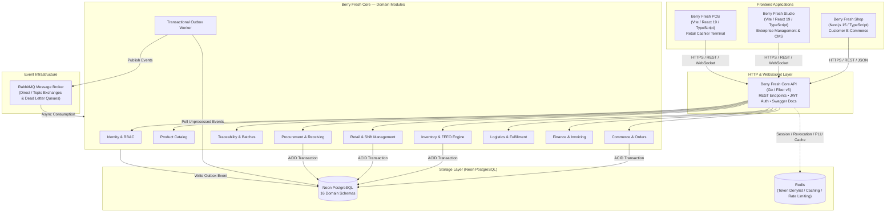
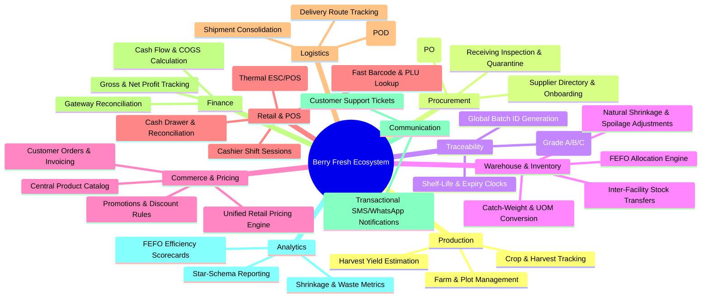
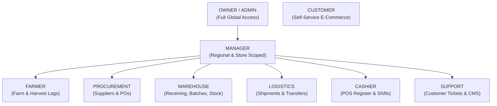
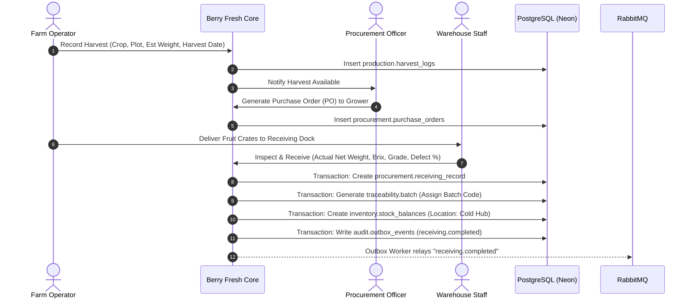
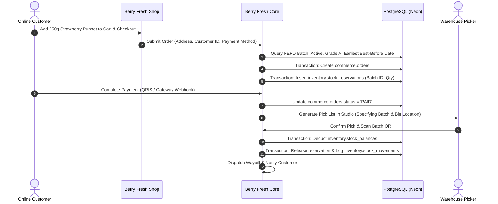
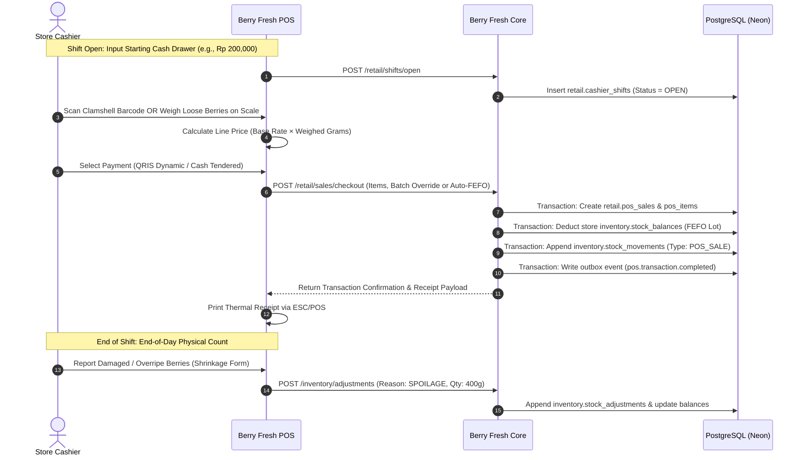

# Berry Fresh — Master Project Blueprint
**Brand Name:** Berry Fresh  
**Main Tagline:** Berry Good Business.  
**Supporting Tagline:** Freshness Connected.  
**Business Category:** Fruit & Agricultural Business Ecosystem  
**Document Version:** 1.0.0 (Foundation Architecture)  
**Target Market:** Indonesia (IDR) Primary with Extensible Multi-Currency / Global Design  

---

## Executive Summary

**Berry Fresh** is an integrated agricultural and fresh fruit supply chain ecosystem connecting upstream production (farms and harvests), midstream handling (procurement, receiving, batch tracing, cold storage, logistics), and downstream retail channels (physical retail stores via POS and direct-to-consumer e-commerce via Shop) into a unified, event-driven digital platform.

The system is architected as a **Modular Monolith (`berry-fresh-core`)** written in **Go (Fiber v3)** backed by **PostgreSQL (Neon)** partitioned across **16 domain schemas**, paired with **RabbitMQ** for reliable asynchronous event processing via the **Transactional Outbox Pattern**. It serves three dedicated frontend clients:
1. **Berry Fresh Shop** (Customer E-Commerce — Next.js 15, TypeScript, Tailwind CSS, Shadcn UI)
2. **Berry Fresh Studio** (Business Management & CMS — Vite, React 19, TypeScript, Tailwind CSS, Shadcn UI)
3. **Berry Fresh POS** (Retail Store Cashier — Vite, React 19, TypeScript, Tailwind CSS, Shadcn UI)

---

## 1. Product Vision & Strategy

### 1.1 The Fresh Produce Problem
Fresh produce—berries in particular (strawberries, blueberries, raspberries, blackberries)—presents unique operational challenges compared to standard retail inventory:
- **High Perishability:** Short shelf life (3 to 7 days in cold chain; 24-48 hours ambient).
- **Quality Degradation & Shrinkage:** Natural moisture evaporation causes continuous weight shrinkage, and physical bruising causes rapid grade downgrading.
- **Traceability Requirements:** Food safety incidents, agrochemical compliance, and harvest lot tracking require end-to-end provenance from field row to retail basket.
- **Unit Complexity:** Fruits are procured in bulk harvest crates (variable catch-weight in kilograms), repacked into discrete consumer clamshells (e.g., 125g, 250g, 500g punnets), or sold loose at POS scales.
- **Channel Friction:** Traditional businesses operate fragmented systems: an e-commerce platform disconnected from retail store POS, and spreadsheets managing warehouse stock, leading to stockouts, overselling expired fruit, and massive food waste.

### 1.2 The Berry Fresh Solution
Berry Fresh integrates the entire lifecycle into one source of truth:
```
Farm → Harvest → Procurement → Receiving → Batch Tracking → Cold Storage → National Distribution → Retail Store (POS) / E-Commerce (Shop) → Customer
```
- **FEFO Engine (First Expired, First Out):** Automatically prioritizes the oldest active lots for fulfillment and retail display to minimize spoilage write-offs.
- **Dual-Unit & Catch-Weight Engine:** Seamlessly converts between bulk receiving weights and consumer pack units while maintaining immutable stock movement audit logs.
- **Unified Commerce Core:** Shop and POS share identical pricing, promotion engines, inventory state, and payment reconciliation models, preventing siloed discrepancies.
- **Progressive AgTech Expansion:** Designed initially for fresh berries and high-value fruits, with immediate architecture readiness for vegetables, herbs, spices, and exotic mushrooms.

---

## 2. Business Overview & Operational Model

### 2.1 Enterprise Structure & Tenancy
Berry Fresh operates as a **Vertically Integrated Enterprise with Scoped Partner Portals**:
- **Enterprise Operator:** Berry Fresh Holdings oversees brand governance, central catalog, national warehouse operations, pricing policies, and corporate finance.
- **Hierarchical Scoping:** Operational data is scoped by `Organization` → `Region` → `Facility` (Warehouse, Distribution Hub, Farm) → `Store` (Retail Outlets) → `Workstation / Register`.
- **Scoped Partner Access:** Contracted growers (Farmers) access farm harvest logs; trusted distributors and commercial clients access fulfillment tracking through RBAC-scoped portals within Berry Fresh Studio.

### 2.2 Sales Channels
1. **`ECOMMERCE`:** Web customer storefront (Shop) fulfilled directly from the Central National Warehouse via cold-chain courier logistics.
2. **`POS`:** Physical retail stores equipped with barcode/QR scanning, cash drawers, receipt printers, and scale inputs.
3. **`MANUAL`:** Direct B2B sales orders, distributor consignments, and institutional catering managed in Studio.

### 2.3 Pricing & Fulfillment Policy
- **National Unified Pricing:** Base retail prices for fresh fruit SKUs are standardized nationwide across POS stores and E-Commerce.
- **Fulfillment Topology:** E-Commerce deliveries ship from the temperature-controlled Central National Warehouse; physical POS stores pull scheduled replenishment stock from the central warehouse via internal transfer orders.

---

## 3. System Architecture

Berry Fresh adheres to a **Modular Monolith** architecture pattern with clean Domain-Driven Design (DDD) boundaries. It avoids premature microservice overhead while enforcing strict internal modularity and event-driven decoupling.



### 3.1 Architectural Principles
1. **Single Source of Truth:** All transactions commit to the PostgreSQL database in strict ACID boundaries using `pgx` driver connection pools.
2. **Transactional Outbox Pattern:** Cross-domain asynchronous effects (e.g., inventory deduction triggers low-stock alerts, or POS sale updates BI facts) write an event record to `audit.outbox_events` in the *same* database transaction as the business mutation. A dedicated background Go worker polls and dispatches these events to RabbitMQ with automatic retries and Dead Letter Queue (DLQ) routing.
3. **Idempotent Consumers:** Every RabbitMQ consumer writes to an `audit.inbox_events` table to guarantee that duplicate deliveries are safely ignored.
4. **Code Generation with `sqlc`:** All database queries are written in raw, optimized SQL and compiled into type-safe Go code with zero runtime reflection overhead.

---

## 4. Application Structure & Workspace Organization

The repository is structured with a **Flat Root Architecture** keeping services cleanly decoupled:

```
fruit_hub/
├── core/                       # Berry Fresh Core (Go Modular Monolith Backend)
│   ├── cmd/
│   │   ├── api/                # HTTP API Server entrypoint
│   │   └── worker/             # Outbox & RabbitMQ background worker entrypoint
│   ├── internal/
│   │   ├── config/             # Environment, flags, and secret parsing
│   │   ├── database/           # pgx pool setup, migrations runner, sqlc generated code
│   │   │   ├── db.go           # sqlc generated DBTX interface & client
│   │   │   └── models.go       # sqlc generated structs
│   │   ├── middleware/         # Auth, RBAC, RateLimit, CORS, Logger, Recover
│   │   ├── outbox/             # Outbox publisher, worker loop, and DLQ handlers
│   │   ├── eventbus/           # RabbitMQ connection, channel pool, consumer registry
│   │   └── modules/            # Domain-Driven Modules
│   │       ├── identity/       # Users, credentials, roles, sessions
│   │       ├── governance/     # Organizations, facilities, stores
│   │       ├── catalog/        # Categories, varieties, products, units
│   │       ├── production/     # Farms, plots, harvest batches
│   │       ├── procurement/    # Suppliers, purchase orders, receiving
│   │       ├── traceability/   # Batches, quality grading, shelf life
│   │       ├── inventory/      # Balances, FEFO allocator, stock movements
│   │       ├── commerce/       # Cart, checkout, orders, pricing engine
│   │       ├── retail/         # POS terminals, cash registers, cashier shifts
│   │       ├── payment/        # QRIS, cash, gateway webhooks (Midtrans/Xendit)
│   │       ├── logistics/      # Shipments, waybills, delivery tracking
│   │       ├── finance/        # Ledger accounts, journal entries, reconciliation
│   │       └── analytics/      # Star-schema facts, aggregates, reporting views
│   ├── migrations/             # golang-migrate sequential UP/DOWN SQL scripts
│   ├── queries/                # sqlc raw SQL query definitions per domain
│   ├── sqlc.yaml               # sqlc configuration
│   ├── go.mod
│   └── go.sum
│
├── shop/                       # Berry Fresh Shop (Customer E-Commerce)
│   ├── src/
│   │   ├── app/                # Next.js App Router (Catalog, Cart, Checkout, Profile)
│   │   ├── components/         # Shadcn UI primitives and Shop customer widgets
│   │   ├── hooks/              # Data fetching, cart store, auth hooks
│   │   ├── lib/                # API client, formatting (IDR currency, dates), analytics
│   │   └── styles/             # Tailwind CSS tokens & Berry Fresh palette
│   ├── public/                 # Static assets, fruit imagery, badges
│   ├── package.json
│   ├── tailwind.config.ts
│   └── tsconfig.json
│
├── studio/                     # Berry Fresh Studio (Enterprise Management & CMS)
│   ├── src/
│   │   ├── views/              # Management modules (Farms, Batches, Inventory, POS Shifts)
│   │   ├── components/         # Data tables, filter bars, batch inspectors, charts
│   │   ├── hooks/              # React Query hooks, auth context
│   │   ├── services/           # Axios/Fetch client with token refresh interceptors
│   │   └── store/              # Zustand state stores
│   ├── index.html
│   ├── package.json
│   ├── vite.config.ts
│   └── tsconfig.json
│
├── pos/                        # Berry Fresh POS (Retail Cashier Terminal)
│   ├── src/
│   │   ├── components/         # Cashier grid, PLU quick keys, cart summary, numpad
│   │   ├── views/              # Cashier Sale, Shift Register, Refund, Cash In/Out
│   │   ├── hardware/           # Web Serial / WebUSB scale & ESC/POS printer drivers
│   │   ├── storage/            # IndexedDB local session and cart recovery cache
│   │   └── services/           # POS API client with offline guard detection
│   ├── index.html
│   ├── package.json
│   ├── vite.config.ts
│   └── tsconfig.json
│
├── docs/                       # Architectural & Technical Documentation
│   ├── architecture/           # Master Blueprint, C4 diagrams, ER diagrams
│   ├── api/                    # OpenAPI 3.0 / Swagger specs
│   └── sprints/                # Sprint plans, test cases, and release notes
│
└── legacy/                     # Archived legacy Node/Express/Mongo code
```

---

## 5. Domain Breakdown & Business Capabilities

The platform is partitioned into **10 Core Business Domains**:



---

## 6. Database Architecture & 16 Schemas

Berry Fresh Core utilizes a single PostgreSQL (Neon) database organized into **16 logical schemas** to enforce bounded domain context without network hops.

### 6.1 Schema Master Directory
| # | Schema Name | Purpose | Primary Tables / Entities |
|---|---|---|---|
| 1 | `identity` | Authentication, credentials, sessions | `users`, `credentials`, `sessions`, `roles`, `user_roles`, `permissions`, `role_permissions` |
| 2 | `governance` | Organizational hierarchy & facilities | `organizations`, `regions`, `facilities`, `stores`, `workstations` |
| 3 | `production` | Upstream agricultural operations | `farms`, `plots`, `crop_types`, `harvest_plans`, `harvest_logs` |
| 4 | `catalog` | Product taxonomy, units, packaging | `categories`, `varieties`, `products`, `units_of_measure`, `packaging_specs`, `product_prices` |
| 5 | `procurement`| Supplier relationships & purchases | `suppliers`, `purchase_orders`, `purchase_order_items`, `receiving_records`, `receiving_items` |
| 6 | `traceability`| Fresh produce batch tracking | `batches`, `quality_inspections`, `grade_history`, `recall_logs` |
| 7 | `inventory` | Physical stock levels & movements | `stock_balances`, `stock_reservations`, `stock_movements`, `stock_adjustments`, `adjust_reasons` |
| 8 | `logistics` | Shipments, transfers, dispatch | `transfer_orders`, `shipments`, `shipment_items`, `waybills`, `delivery_proofs` |
| 9 | `commerce` | E-Commerce orders & payments | `customers`, `customer_addresses`, `carts`, `cart_items`, `orders`, `order_items`, `payments` |
| 10| `retail` | POS cashier operations & shifts | `cash_registers`, `cashier_shifts`, `shift_transactions`, `pos_sales`, `pos_items`, `pos_receipts` |
| 11| `finance` | Accounting, revenue, COGS | `chart_of_accounts`, `journal_entries`, `journal_lines`, `cogs_entries`, `payment_settlements` |
| 12| `communication`| Messaging & notifications | `notification_templates`, `notifications`, `support_tickets`, `ticket_messages` |
| 13| `content` | CMS for Shop & marketing | `banners`, `promo_pages`, `article_posts`, `faq_items` |
| 14| `analytics` | Star Schema dimensional BI | `dim_date`, `dim_product`, `dim_facility`, `dim_batch`, `fact_sales`, `fact_stock_movement`, `fact_waste` |
| 15| `integration`| External webhooks & partners | `webhook_subscriptions`, `webhook_deliveries`, `api_keys`, `sync_logs` |
| 16| `audit` | Reliability & compliance tracking | `audit_logs`, `outbox_events`, `inbox_events` |

### 6.2 Key Relational Constraints & Invariants
1. **Immutable Stock Movements:** The `inventory.stock_movements` table is strictly append-only. Balance updates in `inventory.stock_balances` are driven exclusively by ledger movements (`quantity_change`, `running_balance`, `movement_type`).
2. **Batch Foreign Keys:** Every inventory movement, POS item sale, and e-commerce fulfillment item records the `batch_id` referencing `traceability.batches(id)`, preserving full provenance.
3. **Monetary Precision:** All prices, totals, tax amounts, and discounts are stored as 64-bit integers (`BIGINT`) representing currency base units (Indonesian Rupiah / cents).

### 6.3 Sequential Migration Strategy (`golang-migrate`)
Migrations are sequentially ordered in `core/migrations/` to guarantee zero cyclic foreign-key dependency failures:
- `000001_create_schemas.up.sql`: Initializes all 16 schemas and extensions (`uuid-ossp`, `pgcrypto`).
- `000002_identity_and_governance.up.sql`: Roles, users, organizations, facilities, stores.
- `000003_catalog_and_units.up.sql`: Units of measure, categories, varieties, products, packaging.
- `000004_production_and_procurement.up.sql`: Farms, suppliers, purchase orders, receiving.
- `000005_traceability_and_batches.up.sql`: Batches, quality grades, shelf-life clocks.
- `000006_inventory_and_movements.up.sql`: Stock balances, reservations, movements, adjustment reasons.
- `000007_commerce_and_retail.up.sql`: Orders, POS registers, cashier shifts, sales, receipts.
- `000008_logistics_and_fulfillment.up.sql`: Transfer orders, shipments, delivery tracking.
- `000009_finance_and_settlement.up.sql`: Chart of accounts, journal entries, COGS tracking.
- `000010_outbox_inbox_and_audit.up.sql`: Outbox event log, inbox deduplication table, audit trails.
- `000011_analytics_star_schema.up.sql`: Dimensions and fact tables for Berry Fresh Insights.

---

## 7. User Roles and Hierarchical RBAC

Centralized authentication issues JWT access and refresh tokens stored in browser `localStorage`. Permissions follow a fine-grained resource-action model (`domain:resource:action`) scoped by organization and location.



### 7.1 Role Permission Matrix
| Role | Primary Scope | Permitted Actions |
|---|---|---|
| `OWNER` | Global (All Organizations) | Full superadmin capabilities, financial settlements, executive BI, system configuration. |
| `ADMIN` | Global / Organization | User creation, role assignments, master catalog edits, pricing approvals, audit inspection. |
| `MANAGER` | Region / Facility / Store | Shift approvals, stock adjustment approvals, purchase order approvals, local reports. |
| `FARMER` | Assigned Farm / Plots | Log crop progress, record harvest yields, review harvest delivery manifests. |
| `PROCUREMENT` | Organization | Manage suppliers, issue purchase orders, view supplier delivery ratings. |
| `WAREHOUSE` | Assigned Warehouse / Hub | Physical receiving, batch inspection, FEFO picking, stock counting, internal dispatch. |
| `LOGISTICS` | Fleet / Delivery Hub | Waybill printing, vehicle assignment, in-transit status updates, proof of delivery upload. |
| `CASHIER` | Assigned Store Register | Open/close shift, scan PLUs/barcodes, process payments, print receipts, process return requests. |
| `CUSTOMER` | Self Account | Browse catalog, manage cart, place orders, make payments, track shipments, write reviews. |
| `SUPPORT` | Global / Organization | Respond to customer inquiries, review order histories, issue RMA return tickets. |

---

## 8. Core Business Workflows

### 8.1 Farm-to-Harvest & Procurement Workflow


### 8.2 FEFO Batch Allocation & E-Commerce Fulfillment Workflow


### 8.3 POS Retail Checkout & Shrinkage Workflow


---

## 9. Technology Stack Specification

| Component | Technology | Version | Purpose |
|---|---|---|---|
| **Backend Core** | Go (Golang) | 1.23+ | Ultra-fast, type-safe compiled modular monolith. |
| **HTTP Framework** | Go Fiber | v3 | High-performance, Express-inspired routing and middleware. |
| **Database** | PostgreSQL (Neon) | 16+ | Cloud-native serverless PostgreSQL with connection pooling. |
| **Driver & Connection**| `pgx` (pgxpool) | v5 | High-efficiency native Go PostgreSQL driver. |
| **Type-Safe Queries** | `sqlc` | v1.27+ | Generates idiomatic Go code directly from verified SQL. |
| **Database Migrations**| `golang-migrate` | v4 | Deterministic, file-based SQL schema versioning. |
| **Message Broker** | RabbitMQ | 3.13+ | AMQP 0-9-1 messaging broker for outbox event delivery. |
| **Cache & Sessions** | Redis | 7.2+ | Token denylist, POS PLU cache, and API rate limiting. |
| **API Documentation** | Swagger / OpenAPI | 3.0 | Auto-generated interactive API contracts. |
| **Realtime WebSockets**| Fiber WebSocket | Native | Live POS shift alerts and warehouse pick notifications. |
| **E-Commerce Web** | Next.js (App Router) | 15+ | Server-side rendered (SSR), SEO-optimized customer shop. |
| **Business Studio** | Vite + React | React 19 | Responsive enterprise operations single-page app (SPA). |
| **Retail POS** | Vite + React | React 19 | High-speed retail cashier terminal with local storage guard. |
| **Language (Frontends)**| TypeScript | 5.5+ | End-to-end static typing across all UI codebases. |
| **Styling & Components**| Tailwind CSS + Shadcn | v4 / Latest | Accessible, performant design system and UI components. |
| **Hardware Protocol** | Web Serial / WebUSB | W3C Standard | Scale weight streaming and ESC/POS thermal printer commands. |

### 9.1 Brand Visual Design System
- **Berry Red:** `#A83F52` (Primary Brand & Action Color)
- **Rose Pink:** `#D98291` (Secondary Accents & Highlights)
- **Blush:** `#F2B8C0` (Subtle Badges & Secondary Surfaces)
- **Pastel Pink:** `#FBE5E7` (Hover states & Tinted Card Backgrounds)
- **Cream:** `#FFF8F5` (Primary Application Background)
- **Leaf Green:** `#879B79` (Freshness Indicators, Grade A Badges, In-Stock)
- **Harvest Beige:** `#E8CDAF` (Procurement, Organic & Farm Elements)
- **Charcoal:** `#34343A` (Headings, Primary Text, High-Contrast UI)

---

## 10. Minimum Viable Product (MVP) Scope Definition

To ensure rapid, dependable execution, the 24-week MVP isolates the mission-critical core from advanced phase-2 enterprise features.

### 10.1 In-Scope for MVP
1. **Centralized Identity & RBAC:** Complete user lifecycle, role-based route guards, and scoped permissions for all 10 roles.
2. **Master Fruit Catalog & Dynamic UOM:** Category, variety, quality grading specifications, fixed packaging units (boxes, punnets), and catch-weight conversion logic.
3. **Supplier & Procurement Management:** Supplier directory, purchase orders, dock receiving, and automatic Batch Code generation with shelf-life expiry dates.
4. **FEFO Inventory & Stock Adjustments:** Real-time stock balance tracking per warehouse and store, FEFO reservation logic, and shrinkage/spoilage write-offs.
5. **Berry Fresh Shop (E-Commerce):** Product browsing, cart management, checkout with Indonesian payment options (Dynamic QRIS, bank transfer), and order tracking.
6. **Berry Fresh POS (Retail Terminal):** Cashier shift open/close with cash drawer count, product search/PLU grid, barcode scanning, cart calculation, cash and QRIS payments, and ESC/POS receipt generation.
7. **Berry Fresh Studio (Operations Dashboard):** Operational views for receiving, batches, inventory balances, shift reports, and basic sales KPI cards.
8. **Reliable Event Bus:** Transactional outbox pattern syncing inventory and sales events to RabbitMQ.

### 10.2 Deferred to Phase 2 (Post-MVP)
- Full offline PWA transaction sync for POS (V1 uses local storage guard with online reconnect).
- Autonomous IoT temperature and cold-chain humidity sensor telemetry in shipping trucks.
- Multi-currency international forex checkout (USD/SGD).
- Advanced automated multi-store delivery route optimization algorithms.
- Full double-entry financial general ledger export (GL integration with SAP/Xero).
- Native iOS/Android mobile apps for farm workers.

---

## 11. 24-Week Agile Development Roadmap

Following two-week Scrum sprints, the team executes against the following schedule:

```mermaid
gantt
    title Berry Fresh 24-Week MVP Roadmap
    dateFormat  YYYY-MM-DD
    section Foundation & Prep
    Sprint 0: Setup & Architecture Baseline     :done, s0, 2026-11-09, 14d
    Sprint 1: DB Schemas, Fiber API & Migrations :active, s1, after s0, 14d
    section Core Domains
    Sprint 2: Identity, RBAC & Organization      :s2, after s1, 14d
    Sprint 3: Master Catalog & Dynamic Units     :s3, after s2, 14d
    Sprint 4: Suppliers & Purchase Orders        :s4, after s3, 14d
    Sprint 5: Receiving & Batch FEFO Engine      :s5, after s4, 14d
    Sprint 6: Inventory Movements & Shrinkage    :s6, after s5, 14d
    section Frontends & Sales
    Sprint 7: Studio Operations & CMS Baseline   :s7, after s6, 14d
    Sprint 8: Shop E-Commerce & Customer Flow    :s8, after s7, 14d
    Sprint 9: POS Terminal & Shift Operations    :s9, after s8, 14d
    section Integration & Launch
    Sprint 10: Payment Rails & Inventory Sync    :s10, after s9, 14d
    Sprint 11: Analytics, E2E QA, UAT & Launch   :s11, after s10, 14d
```

### Sprint Breakdown
- **Sprint 0: Project Inception & Workspace Setup (Weeks 1-2)**
  - Archive legacy files into `legacy/`.
  - Initialize `core/` (Go 1.23, Fiber v3, sqlc, golang-migrate).
  - Initialize `shop/` (Next.js 15), `studio/` (Vite React), and `pos/` (Vite React).
  - Setup GitHub Actions CI/CD pipelines, Docker Compose for local PostgreSQL and RabbitMQ.
- **Sprint 1: Database Foundation & Migrations (Weeks 3-4)**
  - Implement sequential migration scripts `000001` through `000011` in Neon PostgreSQL.
  - Configure `sqlc` models and pgx connection pooling.
  - Implement health checks, structured logging (`slog`), and error-handling middleware.
- **Sprint 2: Centralized Identity, Authentication & RBAC (Weeks 5-6)**
  - User registration, login, JWT issuance, and refresh token rotation.
  - Hierarchical organization and facility scoping middleware.
  - Studio and POS login screens with localStorage JWT persistence.
- **Sprint 3: Master Catalog & Dynamic UOM Engine (Weeks 7-8)**
  - Categories, fruit varieties, products, units of measure, and packaging specs.
  - Conversion engine: bulk kg ↔ consumer clamshells.
  - Catalog management UI in Studio.
- **Sprint 4: Supplier Management & Procurement (Weeks 9-10)**
  - Supplier directory and contract terms.
  - Purchase Order creation, approvals, and PDF export.
  - Farm and harvest yield logging modules.
- **Sprint 5: Receiving, Quality Inspection & Batch Tracking (Weeks 11-12)**
  - Dock receiving workflow with Brix/quality grading (Grade A, B, C).
  - Batch ID generator and label printing (QR code with harvest & expiry date).
  - Shelf-life calculation and FEFO priority sorting algorithm.
- **Sprint 6: Inventory Ledger, Balances & Shrinkage (Weeks 13-14)**
  - Append-only stock movement ledger.
  - Real-time stock balance queries by warehouse and retail store.
  - Spoilage, weight shrinkage, and manual stock adjustment audit flows.
- **Sprint 7: Berry Fresh Studio Operations Foundation (Weeks 15-16)**
  - Executive dashboard with inventory valuation and low-stock alerts.
  - Warehouse receiving and batch inspection interfaces.
  - User and permissions management console.
- **Sprint 8: Berry Fresh Shop (E-Commerce Storefront) (Weeks 17-18)**
  - Next.js SSR fruit catalog, search, and category filters.
  - Shopping cart, delivery address validation, and checkout flows.
  - Customer account order tracking and review system.
- **Sprint 9: Berry Fresh POS (Retail Cashier Terminal) (Weeks 19-20)**
  - Cashier shift open/close workflow with cash float management.
  - Fast PLU grid, barcode search, and catch-weight scale input integration.
  - ESC/POS thermal receipt printing layout.
- **Sprint 10: Payment Gateways & Inventory Integration (Weeks 21-22)**
  - Dynamic QRIS generation and Indonesian payment gateway webhooks (Midtrans/Xendit).
  - RabbitMQ Transactional Outbox worker dispatching order/POS completion events.
  - Real-time stock deduction and cross-channel inventory locking.
- **Sprint 11: Analytics, End-to-End QA, UAT & Production Launch (Weeks 23-24)**
  - Berry Fresh Insights: Sales volume, shrinkage rate, and COGS dashboards.
  - Playwright E2E test suites for Shop checkout and POS transactions.
  - k6 load testing, OWASP security scanning, and user acceptance sign-off.

---

## 12. Risks, Mitigations & Technical Dependencies

| Risk Category | Identified Risk | Impact | Architectural Mitigation |
|---|---|---|---|
| **Agricultural** | High spoilage rates due to delayed retail turnover. | High (Direct financial loss) | Automated FEFO picking enforcement; automated markdown discount suggestions for batches approaching 48h to expiry. |
| **Data Integrity** | Dual-write discrepancy between DB commit and RabbitMQ event. | High (Lost inventory updates) | Strict **Transactional Outbox Pattern** guaranteeing zero message loss via DB transaction commits and background delivery retries. |
| **Retail Reliability** | Cashier checkout stalled during brief network downtime. | High (Long retail queues) | POS **Local Session/Cart Guard** caching active cart in `localStorage`/`IndexedDB` with visual reconnection banner; zero cart data lost. |
| **Hardware** | Scale or thermal printer hardware driver incompatibilities in POS. | Medium (Delayed checkout) | W3C Web Serial / WebUSB API with raw ESC/POS command generators; standard USB/Virtual COM port fallbacks. |
| **Performance** | Neon PostgreSQL connection exhaustion during peak sales. | Medium (API latency) | Strict client-side connection pooling via `pgxpool` with PgBouncer connection pooling enabled on Neon. |

---

## 13. Next Steps & Execution Plan

With this validated **Master Project Blueprint** establishing the system foundation:
1. Initialize the repository structure by moving existing legacy template files into `legacy/` and scaffolding the top-level directories: `core/`, `shop/`, `studio/`, `pos/`, and `docs/`.
2. Scaffold `core/` Go modules, Fiber v3 HTTP engine, configuration loaders, and database migration tooling.
3. Write `000001_create_schemas.up.sql` to establish the 16 Neon PostgreSQL schemas.
4. Proceed through Sprint 0 and Sprint 1 deliverables systematically according to the 24-week roadmap.
