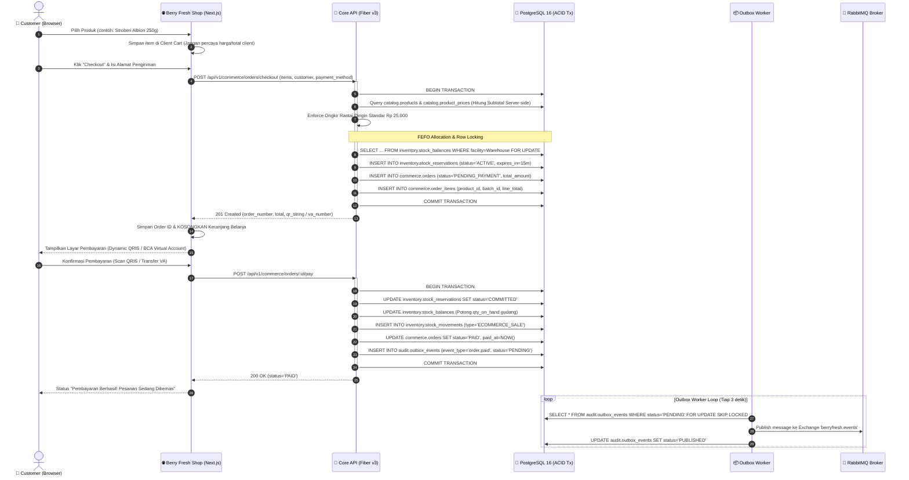
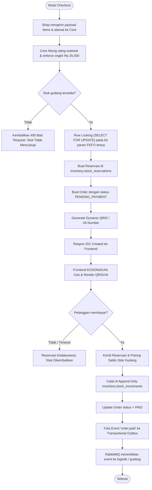
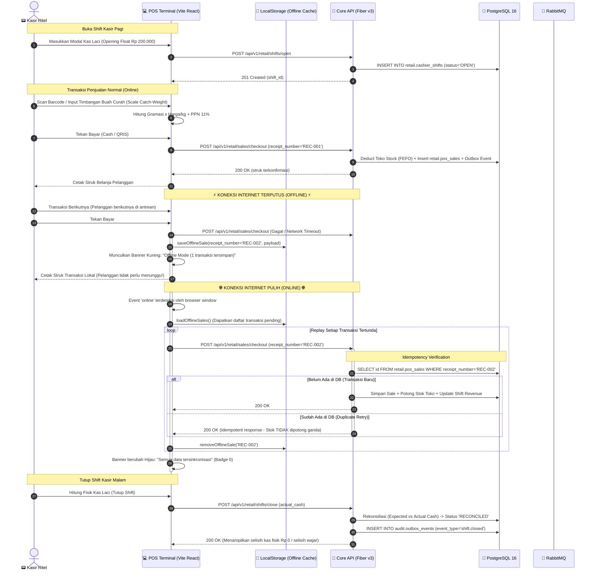
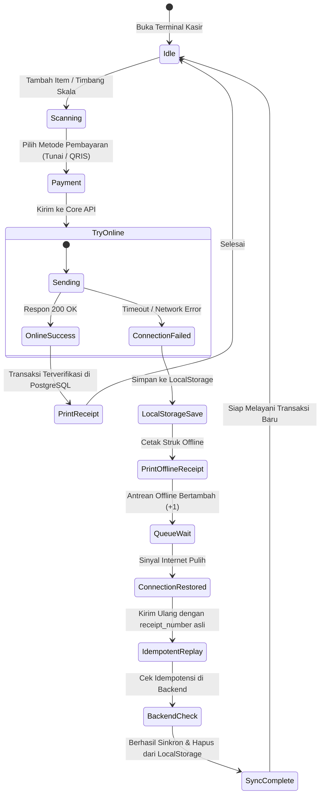

# 🍓 Berry Fresh — Architectural Diagrams & Transaction Flows

Dokumen ini memuat diagram alur teknis interaktif (**Mermaid Diagrams**) untuk dua perjalanan transaksi paling krusial dalam ekosistem Berry Fresh:
1. **Alur Checkout E-Commerce (Shop) dengan Otoritas Harga Server-Side & FEFO Reservation**
2. **Alur Kasir Ritel (POS) dengan Offline Session Guard & Sinkronisasi Idempoten**

---

## 1. Alur Checkout E-Commerce (Shop) & FEFO Reservation

Diagram ini mengilustrasikan perjalanan dari saat pelanggan memilih buah di web store Next.js, pembuatan reservasi lot panen tertua (FEFO), otorisasi pembayaran (Dynamic QRIS / Bank VA), pemotongan stok permanen, hingga penerbitan event RabbitMQ melalui Transactional Outbox.

### 1.1 Diagram Sequence (Interaksi Sistem)

### 1.2 Diagram Alur Logika (Flowchart)

---

## 2. Alur Kasir Ritel (POS) & Offline Session Guard

Diagram ini mengilustrasikan mekanisme keandalan kasir toko fisik: bagaimana kasir tetap dapat memindai barcode, menimbang buah curah (*catch-weight*), melayani pembeli saat koneksi internet putus, menyimpan transaksi ke penyimpanan lokal (*local storage cache*), dan melakukan sinkronisasi otomatis (*idempotent background replay*) saat internet pulih.

### 2.1 Diagram Alur Kerja Kasir & Offline Sync

### 2.2 Diagram Status Transaksi Kasir (State Machine)

